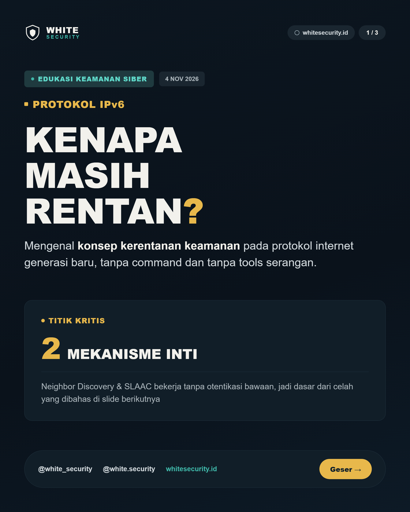
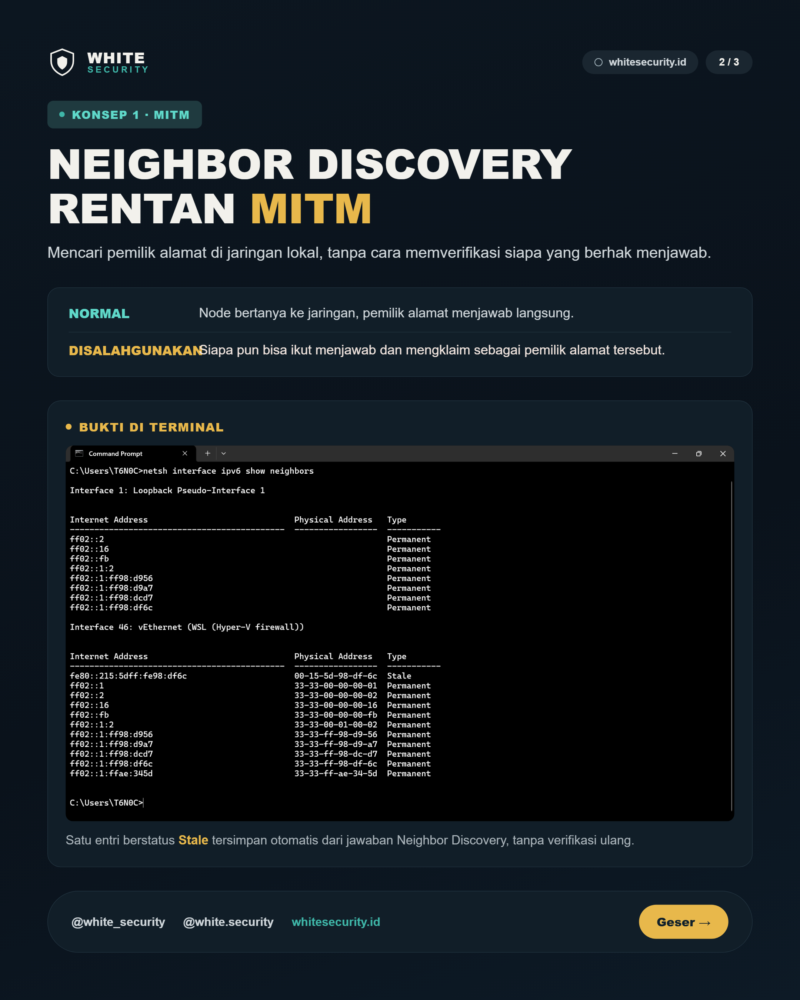
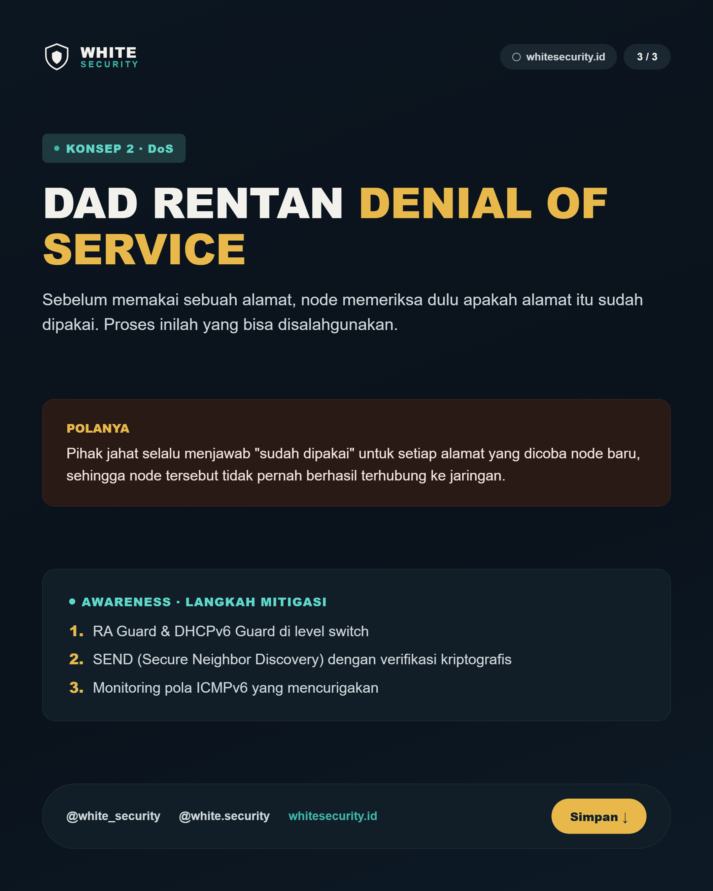

# Edukasi Keamanan IPv6

Materi edukasi singkat tentang keamanan IPv6 — kenapa IPv6 bisa rentan, bagaimana
**Neighbor Discovery** bekerja, dan serangan **Duplicate Address Detection (DAD)**
beserta mitigasinya. Dibuat oleh [whitesecurity.id](https://whitesecurity.id).

> Tujuan: edukasi & kesadaran keamanan jaringan. Bukan alat serangan.

## Materi

### 1. Kenapa IPv6 Rentan

### 2. Neighbor Discovery

### 3. DAD & Mitigasi

---

## Ringkasan

- **IPv6 ≠ otomatis aman.** Banyak jaringan mengaktifkan IPv6 secara default tanpa
  kontrol keamanan yang sama seperti IPv4, sehingga membuka permukaan serangan baru.
- **Neighbor Discovery Protocol (NDP)** menggantikan ARP di IPv6 dan, tanpa proteksi,
  bisa disalahgunakan untuk spoofing / MITM di jaringan lokal.
- **Mitigasi** antara lain: RA Guard, DHCPv6 Guard, SEND (Secure Neighbor Discovery),
  dan segmentasi jaringan yang benar.

## Lisensi

Materi ini dirilis di bawah [CC BY 4.0](https://creativecommons.org/licenses/by/4.0/) —
bebas dibagikan dan diadaptasi selama mencantumkan atribusi ke whitesecurity.id.
